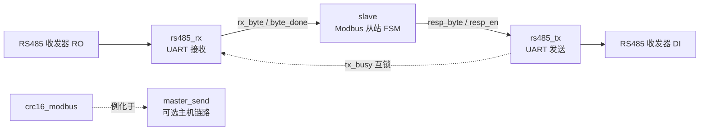

# FPGA Modbus RTU RS485 通信设计

基于 FPGA（Verilog HDL）实现的 **Modbus RTU 从站**通信工程，运行于半双工 RS485 总线，包含完整的 UART 物理层收发链路、CRC16-Modbus 校验模块以及功能码 `0x03`（读保持寄存器）协议处理状态机。

- 目标平台：Xilinx Artix-7（如 XC7A100T），可方便移植到其他厂商 FPGA
- 时钟/波特率：50 MHz / 115200 bps，8 数据位、无校验、1 停止位（8N1）
- 纯 RTL 实现，不依赖任何第三方 IP 核

## 功能特性

- **UART 接收（rs485_rx）**：输入信号三级寄存器同步、下降沿检测起始位、每位中点采样，抗干扰能力强
- **UART 发送（rs485_tx）**：标准 8N1 帧格式发送，带 `tx_busy` 忙标志，支持发送握手
- **CRC16-Modbus（crc16_modbus）**：多项式 `0xA001`（反向表示），预置值 `0xFFFF`，逐字节状态机流水线计算，结果按 Modbus 小端序（低字节先在线上传输）输出
- **Modbus 从站（slave）**：
  - 支持功能码 `0x03` 读保持寄存器
  - 三段式、独热码（one-hot）9 状态 FSM，结构清晰
  - 从机地址、功能码、寄存器数量、地址越界多重合法性校验
  - 非法请求进入 SILENT 静默态丢弃，不产生错误响应
  - 内置 16 个保持寄存器，单次最多读取 6 个寄存器
- **主机发送链路（master_send，可选）**：整帧缓存 + 在线 CRC 追加 + 帧首/帧尾 4 字节静默时间控制，可用于构建 Modbus 主站
- **总线防冲突**：顶层以 `tx_busy` 对接收字节进行互锁，避免半双工总线上自发自收导致冲突
- **自动收发方向**：面向 DE/RE 由硬件自动翻转的 RS485 收发器，FPGA 侧仅需 RX/TX 两根线

## 目录结构

```
.
├── rs485_top.v       # 顶层模块：rs485_rx + slave + rs485_tx
├── rs485_rx.v        # UART 接收模块（串行 bit -> 8bit 字节）
├── rs485_tx.v        # UART 发送模块（8bit 字节 -> 串行 bit）
├── slave.v           # Modbus RTU 从站协议处理（功能码 0x03）
├── master_send.v     # Modbus 主机发送链路（帧缓存 + CRC 追加 + 静默时序）
└── crc16_modbus.v    # CRC16-Modbus 校验模块（多项式 0xA001）
```

## 系统架构



数据通路（默认从站工程，即 `rs485_top`）：

```
uart_rx -> rs485_rx -> 字节流 -> slave -> 响应字节 -> rs485_tx -> uart_tx
```

## 模块说明

### 顶层 `rs485_top`

| 信号 | 方向 | 位宽 | 说明 |
|---|---|---|---|
| sys_clk | I | 1 | 系统时钟，50 MHz |
| sys_rst_n | I | 1 | 异步复位，低电平有效 |
| uart_rx | I | 1 | RS485 接收数据线（接收发器 RO） |
| uart_tx | O | 1 | RS485 发送数据线（接收发器 DI） |

内部通过 `byte_valid = byte_done & (~tx_busy)` 实现收发互锁：发送期间屏蔽接收，既防止自动收发方向电路的回声帧误触发从站，也避免高速总线冲突。

### UART 接收 `rs485_rx`

- 三级 D 触发器同步异步输入，消除亚稳态
- 检测到下降沿（总线空闲为高）且当前未接收时，启动一帧接收
- 波特计数器计到半个位周期开始对每位中点采样，依次移位得到 8 位数据（LSB 先收）
- 停止位中点输出完整字节与 1 拍宽的 `data_done` 脉冲

### UART 发送 `rs485_tx`

| 信号 | 方向 | 说明 |
|---|---|---|
| tx_data[7:0] | I | 待发送字节，`tx_en` 有效时被锁存 |
| tx_en | I | 发送启动脉冲（1 拍） |
| uart_txd | O | 串行输出，空闲为高 |
| tx_busy | O | 发送忙标志，整帧（10 bit）发送期间保持高电平 |

发送顺序：起始位（0）→ D0~D7 → 停止位（1）。

### CRC16-Modbus `crc16_modbus`

| 信号 | 方向 | 说明 |
|---|---|---|
| sclr | I | 同步清零，将 CRC 寄存器复位为 `0xFFFF`（每帧首字节前使用） |
| din[7:0] | I | 数据字节输入 |
| din_vld | I | 输入字节有效脉冲 |
| crc_dout[15:0] | O | 已调整好发送字节序的结果：bit[15:8] 先发（CRC 低字节），bit[7:0] 后发（CRC 高字节） |
| crc_dout_vld | O | 每计算完 1 个字节输出 1 拍有效脉冲 |

内部 FSM：`IDLE -> CRC_XOR -> CRC_CIRCLE -> CRG_0REG / CRG_1REG -> CRC_DONE`，按移出位决定是否异或 `0xA001`。

**验证向量**：

```
输入字节流： 10 03 10 00 00 03
CRC 结果  ： 16'h4A02   （线上发送顺序：4A 02）
```

### Modbus 从站 `slave`

接收状态流：

```
IDLE -> ADDRESS_CODE -> FUNCTION_CODE -> DATA_DISTRICT
     -> FRAME_CHECK -> BUILD_FRAME -> SEND -> IDLE
非法请求 -> SILENT -> IDLE
```

关键设计点：

- 总线上连续 **4 个字节时间**无新数据即判定一帧结束（对应 Modbus RTU 3.5 字符帧间隔要求，本设计按整字节取整为 4）
- 第三段时序逻辑采用"进入脉冲" `enter = cur_st & ~prev_st`，保证各状态初始化动作只在进入状态的第 1 拍执行，避免驻留期间反复清零指针
- 第二段跳转条件全部使用实时信号（`start_en` / 计数满 / `tx_done`），不引入寄存器脉冲，状态不多停留一拍
- 组帧使用常量上界 `QTY_MAX` 的 `for` 循环展开（不能直接以变量 `d_qty` 作上界，否则综合器可能按其 16 位位宽最坏展开 65536 次）

### 主机发送链路 `master_send`（可选，未在顶层例化）

状态流：`ST_RECV -> ST_START -> ST_STRB -> ST_WAIT -> ST_STOP`

- 接收侧逐字节缓存整帧并同步送入 CRC 模块；帧首字节到来时 `sclr` 复位 CRC 寄存器
- 4 字节空闲判定帧结束后，先静默 4 字节时间（前间隔），再依次发送：**原始帧 + CRC 低字节 + CRC 高字节**，最后静默 4 字节时间（尾间隔）
- `busy` 信号在整帧处理期间拉高，可作为高等级总线电平指示
- 需要构建 Modbus 主站时，可用该模块替换顶层中的 `slave`

## 协议示例（功能码 0x03）

主机请求（读从站 0x10、起始地址 0x1000 起的 3 个保持寄存器）：

```
10 03 10 00 00 03 4A 02
^^    ^^ ^^^^^ ^^^^^ ^^ ^^
地址  功能 起始  寄存器 CRC（低字节在前）
      码  地址  数量
```

从站响应（`slave` 当前版本，不含 CRC）：

```
10 03 06 12 34 67 89 11 22
^^    ^^ ^^ \__________/
地址  功能 字节 3 个寄存器数据
      码  数   （高字节在前，默认演示值）
```

保持寄存器默认映射（可在 `slave.v` 的 `initial` 块中替换为真实数据）：

| 寄存器地址 | 默认值 |
|---|---|
| 0x1000 | 0x1234 |
| 0x1001 | 0x6789 |
| 0x1002 | 0x1122 |
| 其余 | 0x0000 |

## 可配置参数

各模块均以 `parameter` 暴露关键参数，顶层统一传递：

| 参数 | 默认值 | 所在模块 | 说明 |
|---|---|---|---|
| CLK_FREQ | 50000000 | 全部 | 系统时钟频率（Hz） |
| UART_BPS | 115200 | 全部 | 串口波特率 |
| SLAVE_ADDR | 8'h10 | slave | 本机从站地址 |
| FRAME_MAX | 16 | slave / master_send | 单帧最大缓存字节数 |
| REG_DEPTH | 16 | slave | 保持寄存器数量 |
| QTY_MAX | 6 | slave | 单次最多读取的寄存器个数 |

修改波特率或时钟频率时，只需改顶层 `rs485_top` 的两处参数，子模块通过例化参数自动适配。

## 快速使用

### 1. 例化顶层

```verilog
rs485_top #(
    .UART_BPS (115200  ),
    .CLK_FREQ (50000000)
) u_rs485_top (
    .sys_clk   (sys_clk ),   // 50 MHz
    .sys_rst_n (sys_rst_n),
    .uart_rx   (uart_rx ),   // -> RS485 收发器 RO
    .uart_tx   (uart_tx )    // -> RS485 收发器 DI
);
```

### 2. 硬件连接

- 推荐选用 **DE/RE 硬件自动收发**（内部自动转向）型 RS485 收发器，FPGA 仅连接 RO→RX、DI→TX
- 若使用常规方向控制型收发器，需额外由发送逻辑产生 DE/RE 使能（发送前置高、停止位结束后拉低，注意留足最后一位发送时间）
- A/B 总线两端按规范加装 120 Ω 终端电阻与偏置电阻

### 3. 上板验证

可用 USB 转 RS485 模块配合 Modbus Poll 等上位机软件，向地址 0x10 发送 `03` 读命令，观察返回数据；也可用逻辑分析仪抓取 A/B 线波形核对帧间隔与字节内容。

## 设计说明与注意事项

1. **从站响应帧暂不含 CRC**：`slave.v` 的响应帧仅包含「地址 + 功能码 + 字节数 + 数据」，请求帧尾部 CRC 字节被接收但不校验（`CRC` 状态为预留）。工程中已提供经在线验证的 `crc16_modbus` 模块，可参照 `master_send` 的例化方式将其接入 `slave` 的收发通路以补齐 CRC 校验/追加。
2. **帧间隔**：代码以 4 个完整 UART 字节时间（434 × 10 × 4 = 17360 个 50 MHz 时钟周期）作为帧分隔判定。
3. **寄存器初始化**：`reg_mem` 使用 `initial` 块赋初值，该写法可被 Xilinx 工具综合为块 RAM/分布式 RAM 的初值；移植到不支持该特性的器件时请改用复位逻辑或初始化文件。
4. **异常码**：当前对地址不符、功能码不符、数量越界等非法请求采取静默丢弃策略，不返回 Modbus 异常响应帧（0x83 + 异常码），可按需扩展。
5. **写功能预留**：功能码 `0x10`（写多个寄存器）已定义参数，后续可在 FSM 中扩展。

## 扩展建议

- 在 `slave` 中接入 `crc16_modbus`：接收路径做 CRC 校验，响应路径追加 CRC 尾，即可成为完整合规的 Modbus RTU 从站
- 增加功能码 0x06（写单个寄存器）/ 0x10（写多个寄存器）支持
- 寄存器空间换用 BRAM，并通过 AXI/自定义接口与 Zynq PS 端或其他逻辑交换数据
- 增加 0x83 异常响应与错误码上报

## License

本项目仅供学习与工程参考，可自由修改使用。
